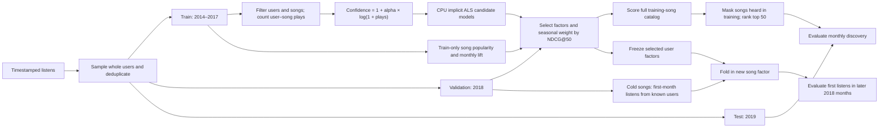

# Music4All-Onion music recommendation

This project evaluates an implicit-feedback collaborative filtering model for **monthly song discovery**. The [Colab notebook](music4all_onion_latent_factor_colab.ipynb) contains the data pipeline, CPU training, evaluation, and inference code. The results below are from its saved **10% user-sample, top-50** run; this README did not rerun the notebook.

## Model architecture

The 2014–2017 training split contains **9.77 million** listening events. After the 5-song-per-user and 5-listener-per-song filters, the matrix has **5,463 users, 41,834 songs, and 2,116,066 observed pairs** (0.93% density). Validation and test each cover a complete year. Validation NDCG@50 was **2.70%** across 5,573 eligible queries and selected **64 factors**, regularization **0.1**, **20** ALS iterations, confidence alpha **20**, and seasonal weight **0.5**. The seasonal adjustment uses training-only month-of-year popularity; weight zero gives pure ALS.

## Saved results

The 2019 table averages **5,312 eligible user-month queries from 580 users**. A query is eligible only when it has a previously unheard song in the fitted training catalog. The same full catalog is ranked for each method, after masking that user's retained training songs.

| 2019 method | Precision@50 | Recall@50 | NDCG@50 | Hit rate@50 |
|---|---:|---:|---:|---:|
| Selected ALS + seasonal lift | 1.62% | 3.68% | 2.82% | 36.58% |
| Same ALS factors, no seasonal lift | **1.65%** | **3.72%** | **2.84%** | 36.43% |
| Global popularity | 0.77% | 1.47% | 1.18% | 22.44% |
| Seasonal popularity | 0.74% | 1.44% | 1.15% | 21.40% |

Validation selected the seasonal weight by NDCG@50. On the later 2019 test, **pure ALS has slightly higher NDCG and recall**, while the selected model has a slightly higher hit rate. These differences are descriptive; the notebook does not report uncertainty intervals.

### Pseudo-warm song diagnostic

The notebook also tests songs absent from all sampled training events. For each song, **1–5 known training users** who listened in its first observed 2018 month supply a new song factor while user factors stay frozen. The factor is evaluated against first listens in later months, ranking the fitted catalog plus available folded-in songs.

The saved run found **4,154 foldable songs**, **7,053 later first-listen labels**, and **2,013 eligible user-month queries from 492 users**. It recorded **zero top-50 hits** for the folded-in songs under this full-catalog ranking protocol; the query-conditioned uniform-random reference has an expected hit rate of **0.40%**. This is an exploratory validation diagnostic: 2018 also helped select the ALS settings, and “first observed” is not a release date.

## Run

Open the notebook in Colab with a **CPU runtime**. Run its dependency cell, restart the session as instructed there, then run the remaining cells in order. The default run samples 10% of users; preprocessing still scans the full timestamp file. Outputs are written under the configured Colab run directory.
