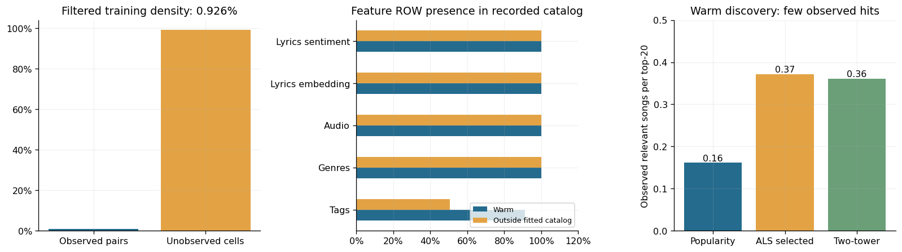
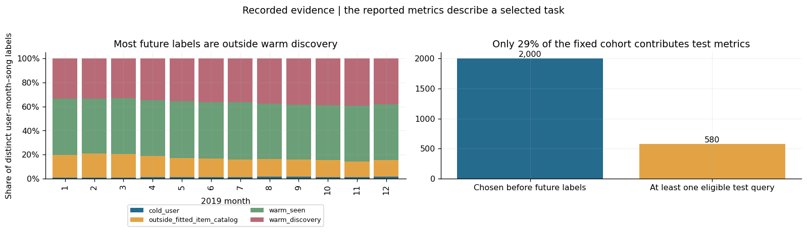
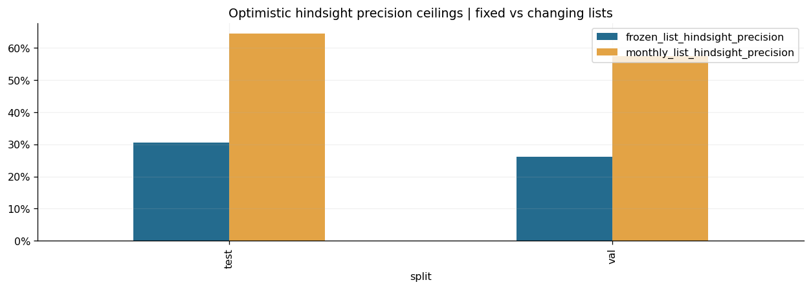

# Why monthly music discovery is difficult

The [Music4All-Onion analysis notebook](music4all_onion_dataset_analysis.ipynb) uses a 10% user sample, trains on 2014–2017 listens, and tests which new songs users will play in each month of 2019. The findings below come from its **saved outputs** and the user-provided lag-12 plot; no notebook cells were run in this workspace.

## Recorded results

| Method | Precision@20 | Hit rate@20 |
|---|---:|---:|
| Popularity | 0.81% | 11.9% |
| ALS | 1.86% | 23.3% |
| Two-tower | 1.81% | 23.1% |

ALS finds about **0.37 observed relevant songs per 20 recommendations**. These are low absolute scores, although they are numerically above the notebook's uniform-random reference (0.06% Precision@20 and 1.18% hit rate) if the query sets and masks match. The notebook does not provide model Recall@20 or NDCG@20 values.

*Notebook cell 8. The middle panel shows feature-row presence, not feature quality.*

## Why the task is hard

1. **Sparse history:** Only **0.93%** of the filtered user–song matrix is observed. **78%** of training events are repeat plays of an existing user–song pair, so many events add no new song coverage (cells 18 and 22).
2. **Narrow evaluation:** Only **36.2%** of 2019 user–month–song labels are warm discovery targets. Just **580 of 2,000 selected users** have an eligible warm test query (cells 7 and 24). The scores describe this subset, not all listening or cold-start recommendations.
3. **Changing monthly targets:** Training stops in 2017, but the model predicts each month of 2019. A future-aware calculation gives a **30.6%** maximum average Precision@20 for one fixed list versus **64.6%** if a perfect list can change monthly (cell 29). These are hindsight limits, not model results.

*Notebook cell 7. “Outside fitted catalog” includes songs lost through filtering; it does not mean every song is globally new.*

*Notebook cell 29. The gap shows a constraint of the frozen monthly task, not the cause of any model's errors.*

**Why split by years?** The training-only lag-12 check supplied from Colab found **r = −0.19** for normalized monthly activity, so it does not support annual seasonality. Full-year 2018 validation and 2019 test windows provide chronological evaluation over comparable 12-month periods; a chronological split at a month or day boundary could also be valid.

**Conclusion:** Sparse supervision, limited target coverage, and an old fixed history make this *specific offline discovery task* difficult. The charts do not prove which factor caused the model scores. Logged plays also do not reveal whether users saw or enjoyed the recommended songs.

The three reference Colab cells in [colab_cells.md](colab_cells.md) analyze aggregate activity, not recommendation errors. The lag-12 result is recorded above.
